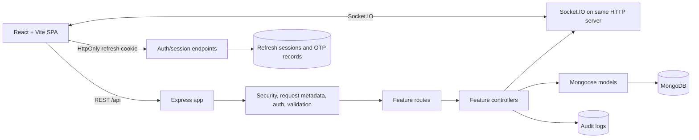

# Architecture

CampusSwap stays a lightweight JavaScript modular monolith. The current folder boundaries are sufficient for the existing feature set; new modules should be introduced when they create a real ownership boundary, not to satisfy a target tree mechanically.

## Request flow

1. Vite serves the SPA; local Docker Nginx serves the production build and proxies `/api` and `/socket.io` to the backend.
2. Express applies CORS, JSON size limits, request IDs/logging, and security middleware.
3. Liveness and readiness routes are available before the API database gate. `/live` checks that the process responds; `/health` and `/api/health` check MongoDB readiness.
4. `/api` requests pass the Mongo availability middleware, then feature routes apply auth, role checks, and boundary validation as needed.
5. Controllers perform request-specific orchestration and use Mongoose models. Read-heavy endpoints should paginate and project returned fields.
6. Socket.IO shares the HTTP server. Existing event behavior remains, but client-provided socket identity is a known security risk documented in the audit.

Authentication adds pending student OTP verification, a separately reviewed alumni path, short-lived access JWTs, cookie-based rotating refresh sessions, and a shared role-permission map. Existing User fields remain during transition; new account state is additive.

## Backend boundaries

Existing routes, controllers, models, and middleware are retained. Keep route files declarative, controllers focused on HTTP translation, shared request behavior in middleware/utilities, and model rules in schemas. Add a service only when business logic is shared or too complex for a controller. Do not move all current files without tests demonstrating behavior preservation.

## Frontend boundaries

The existing `src/pages`, `components`, `layouts`, `context`, `hooks`, and `services` organization remains. Pages compose feature UI, shared state remains in context/hooks, and HTTP behavior belongs in `services/api.js`. `VITE_*` values are public build configuration and must never contain secrets.

## Process lifecycle

The backend listens while MongoDB reconnects, exposes readiness state, retries database connections, and closes Socket.IO, HTTP, and Mongoose on SIGINT/SIGTERM. Compose waits for MongoDB health before starting the backend and for backend liveness before starting the frontend.
